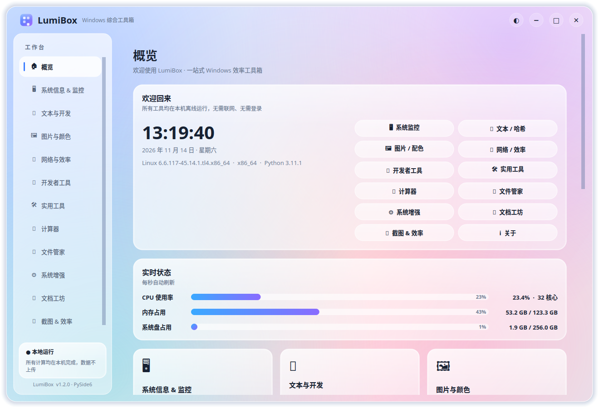
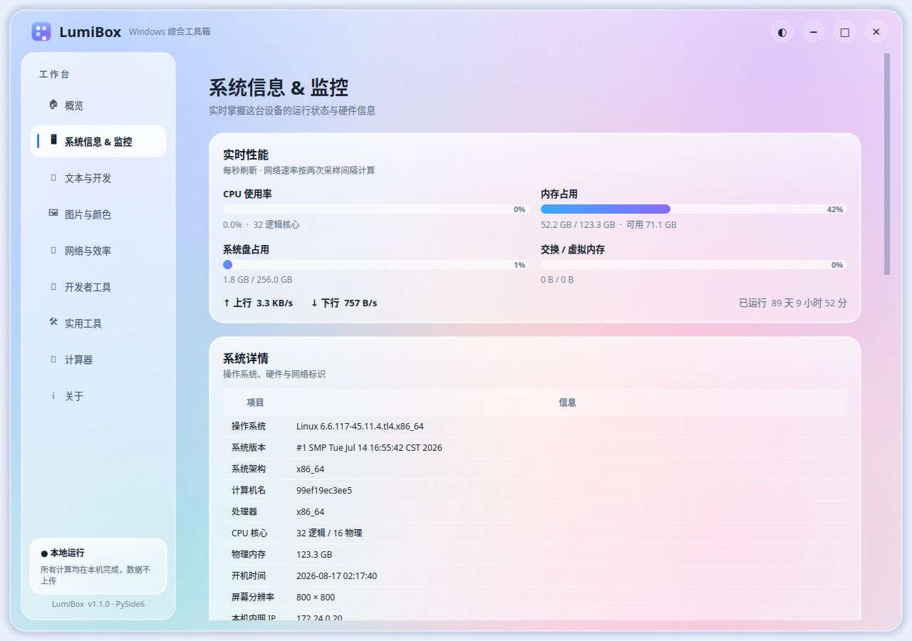
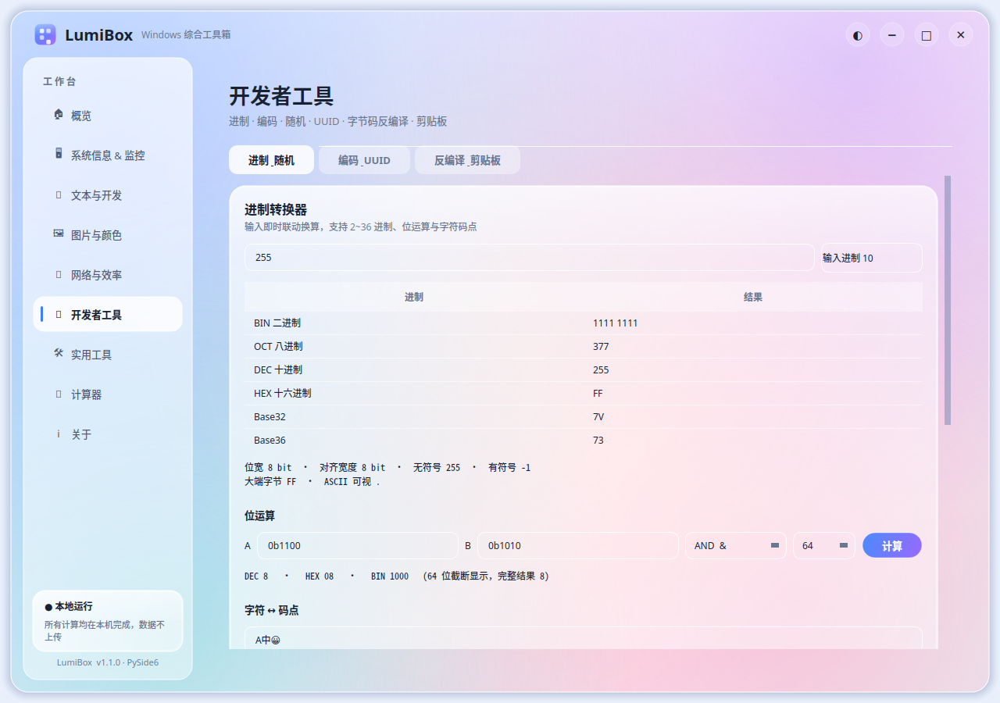
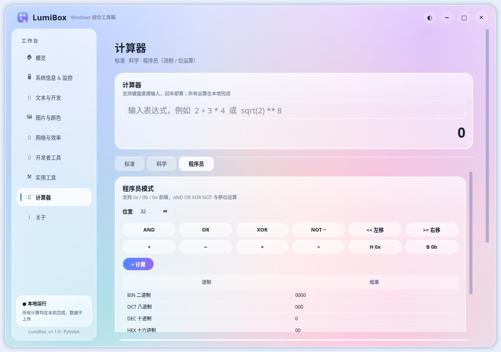
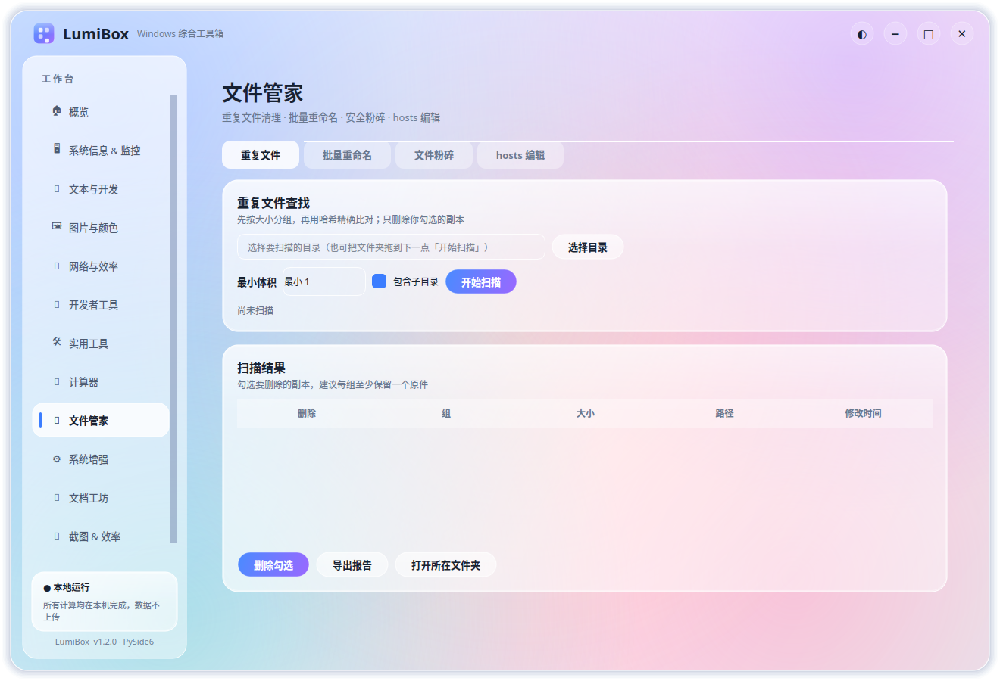
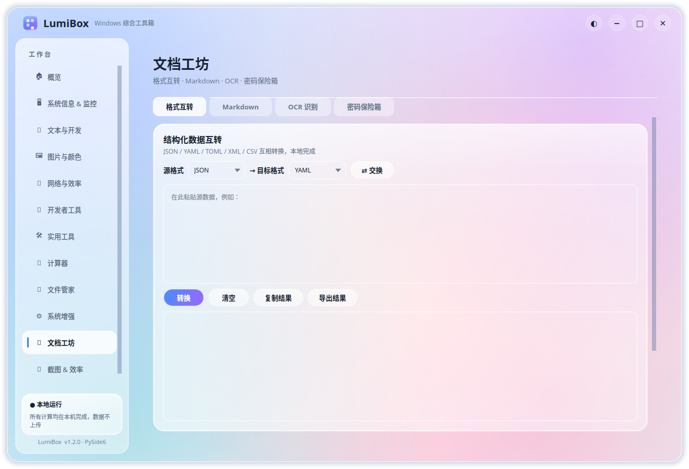
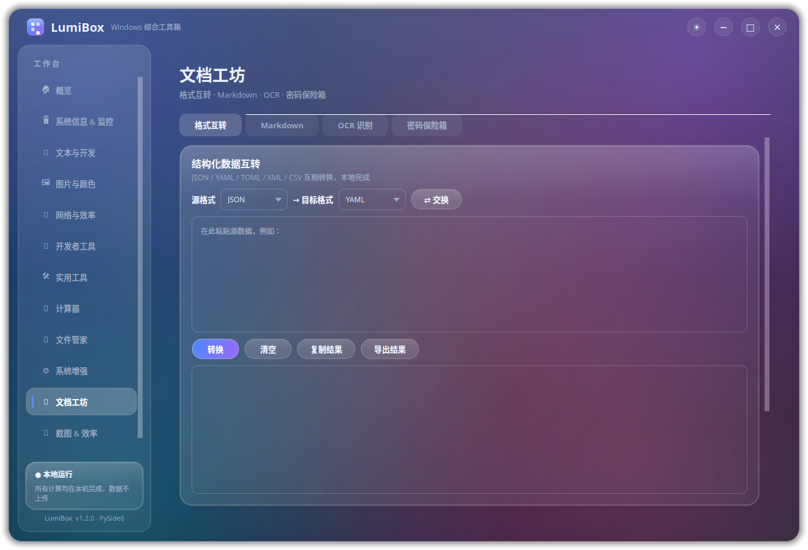
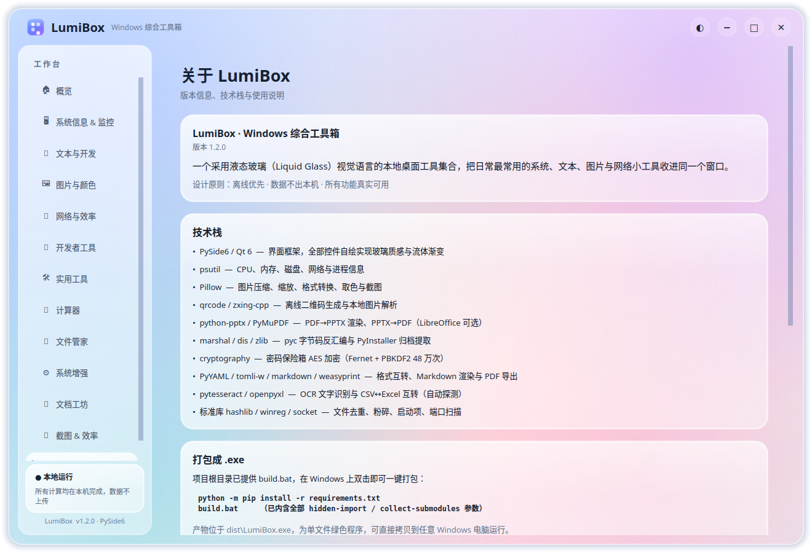

<div align="center">

# LumiBox · Windows 综合工具箱

**一个程序，27+ 实用工具 · 液态玻璃界面 · 100% 本地运算**

基于 Python + PySide6 构建的 Windows 桌面综合工具集，把日常高频的效率、开发、系统、文件、文档工具收进一个窗口。

[](https://www.python.org/)
[](https://www.qt.io/)
[](https://github.com/)
[](LICENSE)
[]()

**无账号 · 无联网上报 · 数据不出机**

</div>

---

## 📸 界面预览

| 概览 | 系统监控 |
|---|---|
|  |  |

| 开发者工具 | 计算器（程序员模式） |
|---|---|
|  |  |

| 文件管家 | 文档工坊 |
|---|---|
|  |  |

| 暗色主题 | 关于 |
|---|---|
|  |  |

> 完整 32 张截图见 [`preview/`](preview/) 目录。

---

## ✨ 功能总览（13 个页面 · 27+ 工具）

### 🖥 系统信息 & 监控
CPU / 内存 / 磁盘 / 交换分区实时监控、上下行网速、运行时长、硬件详情、磁盘分区、内存占用 Top 进程。

### 📝 文本与开发
- **SHA 哈希**：MD5 / SHA-1 / SHA-224~512 / SHA3 / BLAKE2b / BLAKE2s 共 10 种，支持超大文件分块计算
- **Base64**：标准 / URL-safe / Base32 / Base16 双向转换，文件转 Base64
- JSON 格式化与压缩、正则测试、URL / HTML / Unicode 转义、字数统计与文本清洗

### 🖼 图片与颜色
灰度 / 反色 / 翻转 / 旋转 / 锐化 / 模糊、等比缩放、PNG / JPEG / WEBP / BMP 转换与质量调节、点击取色、HEX ↔ RGB / HSL / HSV 换算、调色板与随机和谐配色。

### 🌐 网络与效率
离线二维码生成、时间戳换算、强密码生成（`secrets` + 熵强度评估）、AST 白名单科学计算器、7 类单位换算、IP 与网址可达性检测。

### 🧰 开发者工具
- **进制转换器**：2~36 进制即时联动、位宽 / 字节序 / ASCII、位运算、字符 ↔ 码点
- **编码转换**：UTF-8 / GBK / GB18030 / Big5 / Shift-JIS 等 18 种编码互转、HEX 字节视图、乱码修复
- **随机数生成器**：整数 / 均匀 / 正态 / 列表抽签、不重复抽样、安全随机
- **UUID 批量生成**：v1 / v3 / v4 / v5 / v6 / v7，最多 10 万条，5 种输出格式
- **反编译分析**：`.pyc` 头解析 + 字节码反汇编、PyInstaller 归档（CArchive / PYZ）提取与导出，可选对接 uncompyle6 / decompyle3 / pycdc 还原源码
- **剪贴板历史**：自动捕获 100 条、去重、双击回写、导出

### 🛠 实用工具
- **二维码生成 / 解析**：本地 zxing-cpp 解码，支持图片与剪贴板、多码识别
- **转盘决定**：自绘转盘 + 缓动旋转 + 开奖记录
- **局域网设备扫描**：ping 并发探测 + ARP 表 MAC + OUI 厂商识别 + 导出 CSV
- **磁盘健康查看器**：分区容量、S.M.A.R.T. 状态、温度 / 通电时间、I/O 统计
- **文档格式转换**：PDF → PPTX、PPTX → PDF、PPT ↔ PPTX / PDF（完整版式需本机 LibreOffice）

### 🧮 计算器
标准 / 科学 / 程序员三模式、运算优先级、位运算与位视图、计算历史，支持小键盘全程盲打（数字 → 运算符 → Enter 出结果）。

### 📁 文件管家
- **重复文件去重**：大小分组 → 快速摘要 → 全哈希确认，安全删除与报告导出
- **批量重命名**：序号 / 前后缀 / 查找替换（含正则）/ 大小写 / 时间戳 + 实时预览 + 冲突检测 + 一键撤销
- **文件粉碎机**：多轮随机覆写 + fsync + 改名删除
- **hosts 编辑器**：语法解析、预设模板、自动备份、双击恢复

### ⚙ 系统增强
- **启动项 & 服务**：注册表 Run 项 + 启动文件夹 + 服务状态管理
- **定时任务**：倒计时提醒、定时关机 / 重启、自定义命令
- **端口扫描 & 测速**：并发 TCP 探测（`80,443,8000-8100` 语法）、下载吞吐量测试
- **窗口控制**：置顶开关、30%~100% 透明度调节

### 📄 文档工坊
- **格式互转**：JSON ↔ YAML ↔ TOML ↔ XML ↔ CSV、CSV ↔ Excel（多工作表）
- **Markdown**：实时预览（表格 / 代码高亮）、导出 HTML / PDF
- **OCR 文字识别**：图片 / 剪贴板 / PDF（PDF 有文本层直接提取）——需本机安装 [tesseract-ocr](https://github.com/UB-Mannheim/tesseract/wiki)
- **密码保险箱**：Fernet (AES) + PBKDF2 派生密钥（48 万次迭代）本地加密存储

### 🎯 截图 & 效率
- **截图 & 贴图**：全屏 / 框选截图、可缩放可调透明度的置顶贴图、保存 / 复制
- **番茄钟**：专注 / 短休 / 长休 / 自定义，统计持久化
- **待办清单**：优先级、勾选、编辑、导出

### 🌟 全局能力
系统托盘常驻、`Ctrl + 1~9` 页面切换、`Ctrl + `` ` 隐藏 / 显示、`Ctrl + Alt + S` 快速截图、亮 / 暗液态玻璃双主题。

---

## 🚀 快速开始

### 方式一：一键安装（推荐）

```bash
git clone https://github.com/<你的用户名>/LumiBox.git
```

解压或克隆后，在 Windows 上：

1. **双击 `一键安装运行环境.bat`** —— 自动检测 Python → 安装依赖（失败自动切换清华镜像源）→ 依赖自检 → 启动 LumiBox
2. 以后日常使用，**双击 `run.bat`** 即可

> 需要 [Python 3.10+](https://www.python.org/downloads/)（安装时勾选 *Add to PATH*）。

### 方式二：手动安装

```bash
pip install -r requirements.txt
python main.py
```

### 打包成独立 exe

```bash
双击 build.bat
# 或
python -m PyInstaller --noconfirm --clean --onefile --windowed --name LumiBox --icon assets\app_icon.ico main.py
```

产物为单文件 `dist\LumiBox.exe`，无需 Python 环境即可运行。

---

## 📦 项目结构

```
LumiBox/
├── main.py                 # 入口
├── requirements.txt        # 依赖清单
├── 一键安装运行环境.bat      # 环境一键安装
├── run.bat                 # 日常启动
├── build.bat               # PyInstaller 打包
├── assets/app_icon.ico     # 应用图标
├── preview/                # 32 张界面截图
└── app/
    ├── main_window.py      # 无边框窗口 / 托盘 / 热键
    ├── glass.py            # 液态玻璃自绘控件
    ├── theme.py            # 亮暗主题与全局样式
    ├── extra.py            # 进制 / 编码 / 随机数 / UUID / 反编译逻辑
    ├── power.py            # 去重 / 重命名 / 粉碎 / hosts / 启动项 / 定时任务
    ├── doc_extra.py        # 格式互转 / Markdown / OCR / 保险箱
    ├── system_extra.py     # 局域网扫描 / 磁盘健康 / pyc 解析
    └── pages/              # 13 个功能页面
        ├── home_page.py        ├── system_page.py
        ├── text_page.py        ├── image_page.py
        ├── net_page.py         ├── dev_page.py
        ├── tools_page.py       ├── calc_page.py
        ├── files_page.py       ├── sys_page.py
        ├── doc_page.py         ├── focus_page.py
        └── about_page.py
```

---

## 🔒 隐私与安全说明

- 所有计算**本地完成**，仅「公网 IP 查询」「网址可达性检测」「下载测速」会联网
- 密码保险箱使用主密码本地加密，**主密码丢失无法找回**
- hosts 写入、启动项 / 服务修改、定时关机需要**管理员权限**
- 反编译工具仅用于分析**自有或已获授权**的文件

## 🧩 可选组件

| 组件 | 用途 | 未装的影响 |
|---|---|---|
| [tesseract-ocr](https://github.com/UB-Mannheim/tesseract/wiki)（含 `chi_sim`） | OCR 识别 | OCR 不可用，PDF 文本层提取不受影响 |
| [LibreOffice](https://www.libreoffice.org/) | PPT 旧格式互转 / PPTX→完整版式 PDF | 部分 PPT 转换不可用 |
| [uncompyle6](https://github.com/whtsky/uncompyle6) / [pycdc](https://github.com/zrax/pycdc) | pyc 还原为源码 | 仅反汇编可用，不影响归档提取 |

---

## 🤝 贡献

欢迎 Issue 与 PR！开发时请保持：

- 新功能逻辑写在 `app/extra.py` / `app/power.py` / `app/doc_extra.py` 等纯逻辑模块（与 UI 解耦，便于测试）
- 页面统一使用 `app/glass.py` 玻璃控件与 `app/pages/common.py` 辅助函数
- 保持亮 / 暗双主题均正常显示

## 📄 许可证

[MIT](LICENSE) © 2026 LumiBox Contributors

<div align="center">

**如果这个工具箱帮到了你，欢迎点一个 ⭐ Star**

</div>
